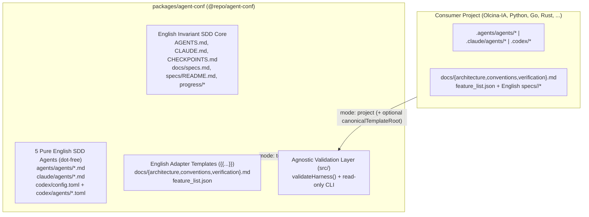

# Design — `agent-conf` (`@repo/agent-conf`)

## 1. Architectural Overview

`packages/agent-conf` (`@repo/agent-conf`) encapsulates the single source of truth for the repository's **pure English Spec Driven Development (SDD)** model and its **stack-agnostic validation layer**. Every system prompt, SDD harness document, adapter template, and feature specification (`specs/<name>/{requirements,design,tasks}.md`) is authored strictly in **English**.

The architecture separates two planes so the harness works identically across hundreds of repositories with heterogeneous languages, build tools, and layouts without editing agent definitions:

1. **Invariant Core SDD Plane (English-only, stack-agnostic, skill-free):**
   - `AGENTS.md`, `CLAUDE.md`, `CHECKPOINTS.md`, `docs/specs.md`, `specs/README.md`, `progress/current.md`, and `progress/history.md`.
   - Multi-platform configurations for **exclusively the 5 SDD workflow agents** (`leader`, `spec_author`, `implementer`, `reviewer`, `commiter`), stored under **dot-free** directories inside the package (`agents/`, `claude/`, `codex/`) for clean packaging and 1:1 mapping onto `.agents/`, `.claude/`, and `.codex/` in target projects.
   - Zero `skills/` directories, zero references to `SKILL.md` / `.agents/skills` / `.claude/skills`, zero `secure-auditer` or `skill-generator` agents, zero Spanish prose, and zero references to concrete project stacks (Turborepo, pnpm, Next.js, React, TypeScript, ESLint, Prettier, Vercel).

2. **Project Adapter Plane + Read-Only Agnostic Validator:**
   - Target-repository specifics live solely in `docs/architecture.md`, `docs/conventions.md`, `docs/verification.md`, and `feature_list.json`.
   - Inside `packages/agent-conf`, those four files are English stack-agnostic templates parameterized with explicit `{{PLACEHOLDER_NAME}}` tokens (`{{PROJECT_NAME}}`, `{{LINT_COMMAND}}`, `{{TEST_COMMAND}}`, etc.).
   - The exported validation library and read-only CLI (`agent-conf-validate`) never mutate files on disk (no `init`, `update`, `install`, `sync`, or `upgrade` commands) and operate in two modes:
     - `mode: "template"`: validates `packages/agent-conf` itself (dot-free platform directories, no `skills/` folders, English-only templates and prompts, zero stack coupling, 5-agent parity, and explicit `{{...}}` placeholders in adapter files).
     - `mode: "project"`: validates any consumer repository (`.agents/`, `.claude/`, `.codex/`, resolved adapter contract with no leftover `{{...}}` or empty mandatory verification commands, English-only canonical docs/prompts/specs, 5-agent syntax/tool boundaries/parity without skills, `feature_list.json` invariants, and strict **English EARS** specs in `specs/<name>/`, plus optional canonical parity comparison against `packages/agent-conf`).



---

## 2. Affected Files and Package Structure

### 2.1 Directory Tree of `packages/agent-conf/`

```text
packages/agent-conf/
├── package.json
├── tsconfig.json
├── tsconfig.build.json
├── eslint.config.mjs
├── README.md
├── AGENTS.md
├── CLAUDE.md
├── CHECKPOINTS.md
├── feature_list.json
├── agents/
│   └── agents/
│       ├── leader.md
│       ├── spec_author.md
│       ├── implementer.md
│       ├── reviewer.md
│       └── commiter.md
├── claude/
│   └── agents/
│       ├── leader.md
│       ├── spec_author.md
│       ├── implementer.md
│       ├── reviewer.md
│       └── commiter.md
├── codex/
│   ├── config.toml
│   └── agents/
│       ├── leader.toml
│       ├── spec_author.toml
│       ├── implementer.toml
│       ├── reviewer.toml
│       └── commiter.toml
├── docs/
│   ├── architecture.md
│   ├── conventions.md
│   ├── specs.md
│   └── verification.md
├── progress/
│   ├── current.md
│   └── history.md
├── specs/
│   └── README.md
├── src/
│   ├── index.ts
│   ├── types.ts
│   ├── constants.ts
│   ├── errors.ts
│   ├── validator.ts
│   ├── cli.ts
│   ├── parsers/
│   │   ├── frontmatter.ts
│   │   ├── toml.ts
│   │   └── markdown.ts
│   └── validators/
│       ├── structure.validator.ts
│       ├── docs-adapter.validator.ts
│       ├── agents.validator.ts
│       └── specs.validator.ts
└── tests/
    ├── helpers.ts
    ├── package-templates.test.ts
    ├── cli.test.ts
    ├── project-adapter.test.ts
    ├── agents-validation.test.ts
    ├── specs-validation.test.ts
    └── dogfooding-repo.test.ts
```

### 2.2 Files Created, Modified, or Removed Across the Repository

| Path | Action | Technical Purpose |
|---|---|---|
| `package.json` | Modified (complete) | Registers `"test": "turbo run test"` at the workspace root (`R18`). |
| `turbo.json` | Modified (complete) | Adds `"dist/**"` to `tasks.build.outputs` and registers `"test": { "dependsOn": ["build", "^build"] }` (`R18`). |
| `packages/agent-conf/{AGENTS.md,CLAUDE.md,CHECKPOINTS.md,feature_list.json,docs/*,progress/*,specs/README.md}` | Migrate to English | Author all 11 base and adapter SDD templates strictly in English with `{{...}}` markers in the 4 adapter files (`R4`, `R7`, `R8`, `R9`). |
| `packages/agent-conf/{agents,claude,codex}/**` | Migrate to English | Author all 15 pure SDD agent files (`leader`, `spec_author`, `implementer`, `reviewer`, `commiter`) + `codex/config.toml` strictly in English with cross-platform parity (`R3`, `R5`, `R6`, `R7`, `R14`). |
| `packages/agent-conf/src/constants.ts` | Modify | Add `"NON_ENGLISH_CONTENT"` to `VALIDATION_RULE_CODES`; replace Spanish EARS regexes with strict English EARS patterns (`SHALL` / `SHALL NOT`), English weak-verb regex, non-English EARS keyword detector, English pending markers, and residual Spanish detection patterns (`R13`, `R16`). |
| `packages/agent-conf/src/parsers/markdown.ts` | Modify | Provide helper to scan Markdown lines (ignoring fenced code blocks, inline code spans `` `...` ``, and managed `<!-- BEGIN:... -->` blocks) for residual Spanish tokens (`R13`). |
| `packages/agent-conf/src/validators/{structure,docs-adapter,agents,specs}.validator.ts` | Modify | Enforce `NON_ENGLISH_CONTENT` on template files (`template` mode), canonical SDD files, 15 agent prompts, and `specs/<name>/*.md`; enforce strict English EARS in `specs.validator.ts`; align section/table checks with English headings (`R10`–`R17`). |
| `packages/agent-conf/tests/*.test.ts` & `tests/helpers.ts` | Modify | Migrate fixtures to English and add concrete tests for English EARS (`SHALL` / `SHALL NOT`), rejection of `DEBE`/`CUANDO` and weak verbs (`can`, `should`, `supports`, etc.), and `NON_ENGLISH_CONTENT` errors (`R1`–`R20`). |
| `AGENTS.md`, `CLAUDE.md`, `CHECKPOINTS.md`, `docs/specs.md`, `progress/current.md`, `progress/history.md`, `specs/README.md` | Modify (Dogfooding) | Sync root SDD harness files in English from `packages/agent-conf`, preserving the `<!-- BEGIN:turborepo-agent-rules -->` block in root `AGENTS.md` (`R7`, `R19`). |
| `.agents/agents/*.md`, `.claude/agents/*.md`, `.codex/config.toml`, `.codex/agents/*.toml` | Modify (Dogfooding) | Sync all 15 root SDD agent definitions in English from `packages/agent-conf`; keep `secure-auditer` and `skill-generator` absent (`R5`, `R6`, `R7`, `R19`). |
| `docs/architecture.md`, `docs/conventions.md`, `docs/verification.md`, `feature_list.json` | Modify (Dogfooding) | Migrate `Olcina-IA` adapter docs and root `feature_list.json` description to English, documenting `@repo/agent-conf` and active mandatory `pnpm test` (`R7`, `R20`). |

---

## 3. Package Configuration and Test Runner Integration

`packages/agent-conf/package.json` follows the compiled internal package pattern documented in the installed `turbo` package (`node_modules/turbo/docs/crafting-your-repository/creating-an-internal-package.mdx`):

- **Zero runtime dependencies:** built exclusively on Node.js >= 24 standard modules (`node:fs`, `node:path`, `node:process`, `node:url`).
- **Dual TypeScript config:** `tsconfig.build.json` compiles `src/` into `dist/` (no `*.test.js` emitted), while `tsconfig.json` type-checks both `src/` and `tests/` via `tsc --noEmit`.
- **Native `node --test` runner:** `tests/*.test.ts` self-reference `@repo/agent-conf`, resolving types from `./src/index.ts` during `check-types` and executing compiled `./dist/index.js` at runtime after Turborepo runs `build` (`"dependsOn": ["build", "^build"]`).

---

## 4. Public Contracts, Types, and Signatures (`src/`)

All constants and rule codes use `as const` literal unions (avoiding `enum` and `any`).

### 4.1 `src/constants.ts` and `src/types.ts`

```ts
export const SDD_AGENTS = [
  "leader",
  "spec_author",
  "implementer",
  "reviewer",
  "commiter",
] as const;

export type SddAgentName = (typeof SDD_AGENTS)[number];

export const AGENT_PLATFORMS = ["agents", "claude", "codex"] as const;
export type AgentPlatform = (typeof AGENT_PLATFORMS)[number];

export const VALID_FEATURE_STATUSES = [
  "pending",
  "spec_ready",
  "in_progress",
  "done",
  "blocked",
] as const;

export type FeatureStatus = (typeof VALID_FEATURE_STATUSES)[number];

export type ValidationMode = "template" | "project";
export type ValidationSeverity = "error" | "warning";

export const VALIDATION_RULE_CODES = [
  "HARNESS_MISSING_PATH",
  "HARNESS_EMPTY_FILE",
  "NON_ENGLISH_CONTENT",
  "TEMPLATE_FORBIDDEN_DOT_DIR",
  "TEMPLATE_FORBIDDEN_SKILLS_DIR",
  "TEMPLATE_STACK_COUPLED_CONTENT",
  "TEMPLATE_MISSING_PLACEHOLDER",
  "ADAPTER_UNRESOLVED_PLACEHOLDER",
  "ADAPTER_MISSING_SECTION",
  "VERIFICATION_INVALID_TABLE",
  "VERIFICATION_EMPTY_COMMAND",
  "AGENT_UNEXPECTED_FILE",
  "AGENT_MISSING_FILE",
  "AGENT_INVALID_SYNTAX",
  "AGENT_INVALID_CONTRACT",
  "AGENT_ROLE_TOOL_VIOLATION",
  "AGENT_FORBIDDEN_REFERENCE",
  "AGENT_PARITY_MISMATCH",
  "CANONICAL_SYNC_MISMATCH",
  "FEATURE_LIST_INVALID_JSON",
  "FEATURE_LIST_INVALID_SCHEMA",
  "FEATURE_LIST_MULTIPLE_IN_PROGRESS",
  "SPEC_MISSING_FILE",
  "SPEC_INVALID_EARS",
  "SPEC_INVALID_DESIGN",
  "SPEC_INVALID_TASKS",
  "SPEC_ORPHAN_REQUIREMENT",
  "SPEC_UNCHECKED_DONE_TASK",
] as const;

export type ValidationRuleCode = (typeof VALIDATION_RULE_CODES)[number];

export interface ValidationIssue {
  readonly code: ValidationRuleCode;
  readonly severity: ValidationSeverity;
  readonly message: string;
  readonly filePath: string;
  readonly line?: number;
}

export interface ValidateHarnessOptions {
  readonly rootDir: string;
  readonly mode: ValidationMode;
  readonly canonicalTemplateRoot?: string;
}

export interface ValidationSummary {
  readonly rootDir: string;
  readonly mode: ValidationMode;
  readonly checkedFiles: number;
  readonly errorCount: number;
  readonly warningCount: number;
}

export interface ValidationResult {
  readonly valid: boolean;
  readonly issues: readonly ValidationIssue[];
  readonly summary: ValidationSummary;
}

export interface CliExecutionResult {
  readonly exitCode: 0 | 1 | 2;
  readonly stdout: string;
  readonly stderr: string;
}
```

### 4.2 Exported Functions (`src/index.ts`)

```ts
export function validateHarness(options: ValidateHarnessOptions): ValidationResult;
export function assertValidHarness(options: ValidateHarnessOptions): ValidationSummary;
export function formatValidationReport(result: ValidationResult): string;
export function stripManagedBlocks(markdown: string): string;
export function runCli(argv: readonly string[], cwd?: string): CliExecutionResult;
```

### 4.3 English Language and Strict English EARS Rules

1. **English-Only Enforcement (`NON_ENGLISH_CONTENT`):**
   - Applied to:
     - All scanned template and agent files in `mode: "template"`.
     - Canonical SDD files (`AGENTS.md` outside `<!-- BEGIN:... -->...<!-- END:... -->` blocks, `CLAUDE.md`, `CHECKPOINTS.md`, `docs/specs.md`, `specs/README.md`), all 15 SDD agent files (Markdown frontmatter `description` + body, and Codex `description` + `developer_instructions`), and all active SDD spec files (`specs/<name>/{requirements,design,tasks}.md`) in `mode: "project"`.
   - Line scanner ignores fenced code blocks and inline backtick spans (`` `...` ``) so literal examples inside backticks never produce false positives, and flags Spanish diacritics/inverted punctuation (`/[¡¿áéíóúñüÁÉÍÓÚÑÜ]/`) or Spanish structural keywords (`/\b(eres|debe|deben|cuando|mientras|donde|entonces|arquitectura|convenciones|requisitos|tareas|bitacora|ninguna|proyecto|reglas|flujo|agente|agentes|subagente|subagentes|archivo|archivos|carpeta|carpetas|obligatorio|opcional|pendiente|criterios|humano|humana)\b/i`) with exact `filePath` and `line`.

2. **Strict English EARS Grammar (`SPEC_INVALID_EARS` in `specs.validator.ts`):**
   - Sequential requirement IDs `R1..Rn` with no duplicates or gaps.
   - After stripping inline code spans `` `...` `` and bold/italic markers:
     - **English EARS patterns (`EARS_PATTERNS`):**
       - Ubiquitous: `/^The system (?:SHALL NOT|SHALL)\b/`
       - Event-driven: `/^WHEN\b.+,\s*the system (?:SHALL NOT|SHALL)\b/`
       - State-driven: `/^WHILE\b.+,\s*the system (?:SHALL NOT|SHALL)\b/`
       - Optional: `/^WHERE\b.+,\s*the system (?:SHALL NOT|SHALL)\b/`
       - Unwanted: `/^IF\b.+?,?\s+THEN the system (?:SHALL NOT|SHALL)\b/`
     - **Non-English EARS keyword check (`EARS_NON_ENGLISH_KEYWORD_REGEX`):** `/\b(DEBE|CUANDO|MIENTRAS|DONDE|ENTONCES)\b/` immediately reports `SPEC_INVALID_EARS`.
     - **Single normative clause (`EARS_SHALL_REGEX`):** `/\bSHALL\b/gi` must match **exactly once** per requirement (`SHALL` or `SHALL NOT`, and uppercase `SHALL` is verified via `EARS_PATTERNS` + `/\bSHALL\b/g`).
     - **Forbidden weak verbs (`EARS_WEAK_VERB_REGEX`):** `/\b(can|could|may|might|should|support|supports|puede|pueden|podría|podrían|debería|deberían|soporta|soportan)\b/i` reports `SPEC_INVALID_EARS`.

3. **Adapter, Agent Parity, and CLI Rules:**
   - `docs-adapter.validator.ts` checks English required headings in `docs/architecture.md` (structure/layout, architectural principles/boundaries, what not to do/anti-patterns), `docs/conventions.md` (language/commits, naming/style conventions, testing, error handling), and `docs/verification.md` (Markdown table with static analysis/lint and automated test rows, backtick-wrapped commands, rejecting `pending configuration`, `not configured`, `TBD`, `TODO`, `N/A`, or empty cells on mandatory rows).
   - `agents.validator.ts` enforces exact membership of the 5 pure SDD agents, role tool restrictions across Antigravity/Claude/Codex, zero references to skills (`SKILL.md`, `.agents/skills`, `.claude/skills`, `.codex/skills`, `load skills`), `secure-auditer`, or `skill-generator`, H1/H2/output-contract parity across all 3 platforms, and normalized canonical equality when `canonicalTemplateRoot` is supplied.
   - `cli.ts` supports `--mode <project|template>`, `--root <dir>`, `--canonical-root <dir>`, `--json`, and `--help`, returning `exitCode: 2` without disk writes on `init`, `update`, `install`, `sync`, `upgrade`, or unknown flags.

---

## 5. Error and Exception Handling

Defined in `src/errors.ts`:

- **`CliUsageError extends Error`**: thrown internally by `cli.ts` argument parsing when forbidden mutation subcommands (`init`, `update`, `install`, `sync`, `upgrade`) or invalid flags are passed; caught by `runCli()` to return `exitCode: 2` and clean `stderr` output without stack traces.
- **`HarnessValidationError extends Error`**: exposes `readonly result: ValidationResult` and is thrown exclusively by `assertValidHarness(options)` when `result.valid === false`.
- **`validateHarness(options)` never throws on validation failures or malformed files**: filesystem missing paths, malformed JSON, invalid YAML frontmatter, or broken TOML inside the target root are converted deterministically into `ValidationIssue` entries. Only invalid `options` (`rootDir` empty or `mode` invalid) throw `TypeError`.

---

## 6. Discarded Alternatives

### Alternative 1 — Interactive Scaffolding CLI (`init` / `update`) with Dynamic Template Rendering
- **Description:** Build an interactive CLI (`agent-conf init`, `agent-conf update`) using a templating engine (Handlebars/EJS) to generate and overwrite harness files in target repositories.
- **Reason for Rejection:** Explicitly excluded by feature requirements and KISS principles. Across hundreds of heterogeneous repositories, mutating CLIs risk overwriting project-specific `docs/{architecture,conventions,verification}.md` adaptations or tool-managed blocks (such as Turborepo's block in `AGENTS.md`). Shipping static English templates (`agents/`, `claude/`, `codex/`, `docs/`, etc.) paired with a deterministic read-only validator lets teams copy/version files cleanly and enforce compliance in CI without side effects.

### Alternative 2 — External Runtime and Testing Dependencies (`vitest`, `yaml`, `@iarna/toml`, `zod`)
- **Description:** Add Vitest as the workspace test runner alongside third-party YAML, TOML, and schema validation libraries inside `packages/agent-conf`.
- **Reason for Rejection:** Repository engineering rules discourage unnecessary dependencies. The workspace targets `"node": ">=24"` and `"typescript": "7.0.2"`. Node.js 24 ships `node:test` and `node:assert/strict` with native `.test.ts` execution, and the YAML frontmatter / Codex TOML subset used by the 5 SDD agents is flat and deterministic. Keeping `@repo/agent-conf` at zero runtime dependencies avoids supply-chain bloat, prevents peer-dependency friction with `typescript@7.0.2` / `eslint@10.9.1`, and guarantees portable validation anywhere Node >= 24 runs.
